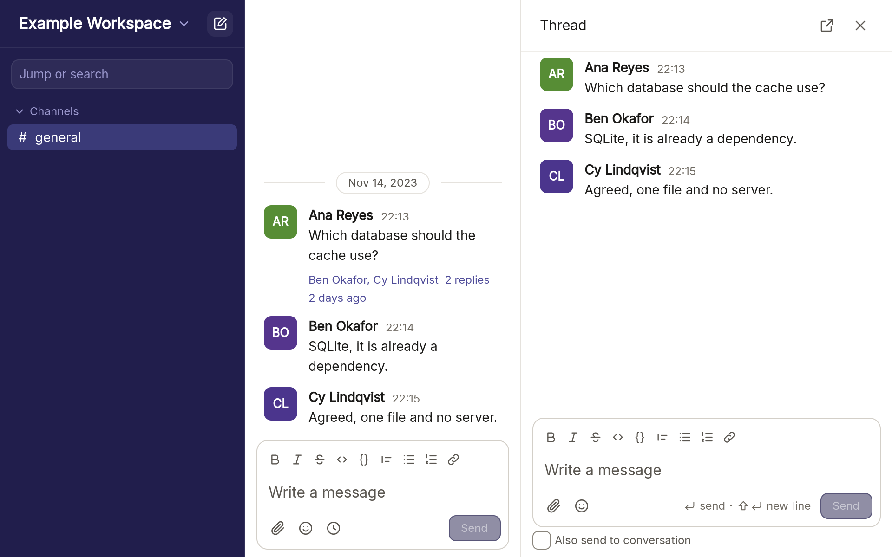

  <picture>
    <source media="(prefers-color-scheme: dark)" srcset="assets/brand/logo-dark.svg">
    
  </picture>

<h1 align="center">Parla</h1>

  An open-source, low-resource desktop client for Slack, written in Rust.

  <a href="https://oscarbc96.github.io/parla/"><strong>Website</strong></a> ·
  <a href="https://oscarbc96.github.io/parla/docs/">Docs</a> ·
  <a href="https://oscarbc96.github.io/parla/docs/install/">Install</a> ·
  <a href="https://oscarbc96.github.io/parla/docs/keymap/">Keymap</a> ·
  <a href="https://oscarbc96.github.io/parla/docs/troubleshooting/">Troubleshooting</a>
   
  <a href="https://oscarbc96.github.io/parla/es/">Español</a> ·
  <a href="https://oscarbc96.github.io/parla/ca/">Català</a>

  <picture>
    <source media="(prefers-color-scheme: dark)" srcset="crates/ui_testing/baselines/macos/components/thread_open@2x-dark.png">
    
  </picture>

> **Unofficial.** Not created by, affiliated with, or supported by Slack
> Technologies, LLC. Use at your own risk.

## What it does

- **Native speed.** Drawn on the GPU with
  [GPUI Fast](https://github.com/longbridge/gpui-fast) and
  [gpui-kit](https://github.com/longbridge/gpui-kit). Switching and search
  never wait on a browser engine.
- **Low memory.** One process, one UI thread, and an encrypted local cache
  whose size you set.
- **Many workspaces.** Every workspace stays signed in, with a switcher,
  per-workspace badges and one unified unreads view.
- **Keyboard first.** Quick switcher, command palette, jump to unread, and a
  JSONC keymap where every action has a stable name.
- **Huddles, files and quiet notifications.** Live huddles in the sidebar,
  in-place image and video previews, and per-conversation notification levels.
- **Themes.** JSON themes that hot reload. Override one token or a whole
  palette.
- **Local MCP server.** AI agents on the same machine can read your sessions,
  and write only after you confirm (by default). Off by default and local only.

See the [docs](https://oscarbc96.github.io/parla/docs/) for the full tour.

## Status

In early development. macOS builds (14 or later, Apple silicon and Intel, one
universal dmg, self-signed) are on
[GitHub Releases](https://github.com/oscarbc96/parla/releases). Windows and
Linux: build from source with the
[install guide](https://oscarbc96.github.io/parla/docs/install/).

## How sign-in works

Parla signs in with **your own Slack web session**, the same approach
[emacs-slack](https://github.com/emacs-slack/emacs-slack) and
[wee-slack](https://github.com/wee-slack/wee-slack) use. You log in to Slack
once (in an embedded login window, or by pasting a token and cookie from your
browser), and the client then talks to Slack as your web browser does. There
is no Slack app to create and no admin approval step, and it works across any
number of your devices, with typing indicators, presence and unread counts.

**This uses endpoints Slack does not document, and a session token that is
your full account access.** Read the
[privacy notice](https://oscarbc96.github.io/parla/docs/privacy/) and
[sign-in guide](https://oscarbc96.github.io/parla/docs/sign-in/) before you
rely on it. It may break your employer's IT policy, and Slack may change how
its web client works and break sign-in at any time.

## Contributing

Bug reports and pull requests are welcome. Start with
[CONTRIBUTING.md](CONTRIBUTING.md). Report security issues privately, as
described in [SECURITY.md](SECURITY.md). Never paste tokens, cookies or
unredacted logs into an issue.

## Licence

[MPL-2.0](LICENSE). The plugin API and SDK are `Apache-2.0 OR MIT`
([LICENSE-APACHE](LICENSE-APACHE), [LICENSE-MIT](LICENSE-MIT)), and the docs
are `CC-BY-4.0` ([LICENSE-DOCS](LICENSE-DOCS)). Bundled assets and third-party
software are listed in [NOTICE](NOTICE); see [TRADEMARKS.md](TRADEMARKS.md)
for the trademark notice.
